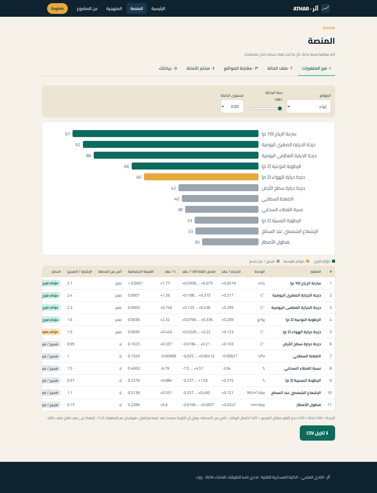
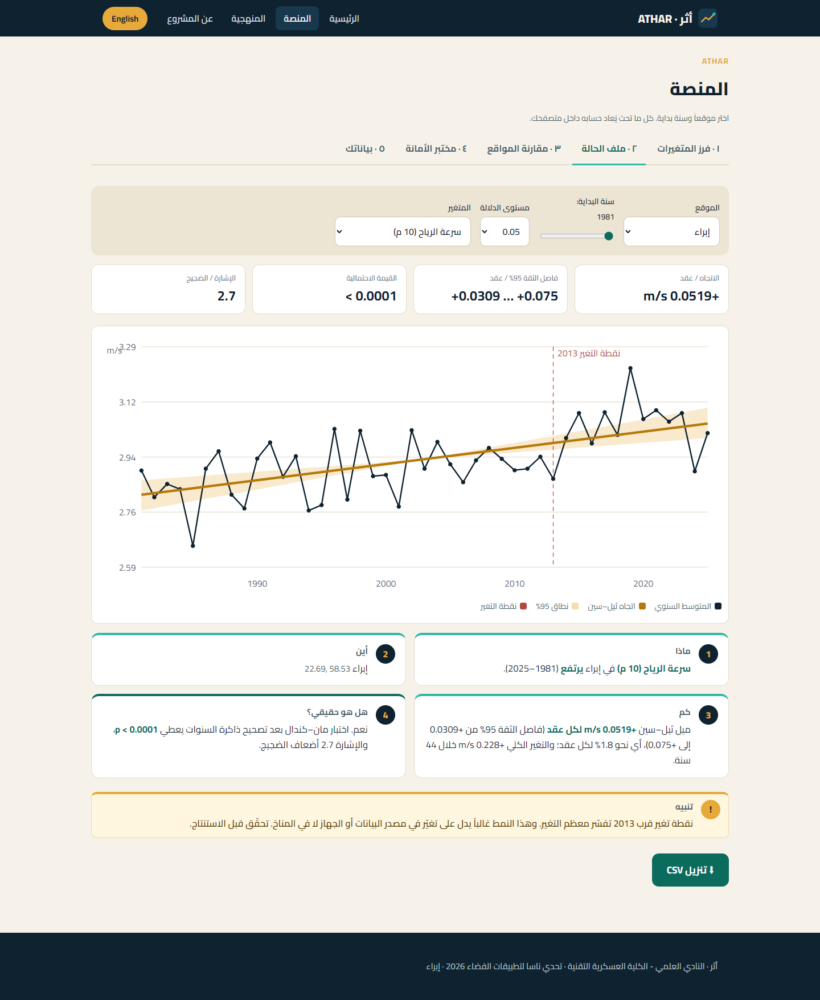
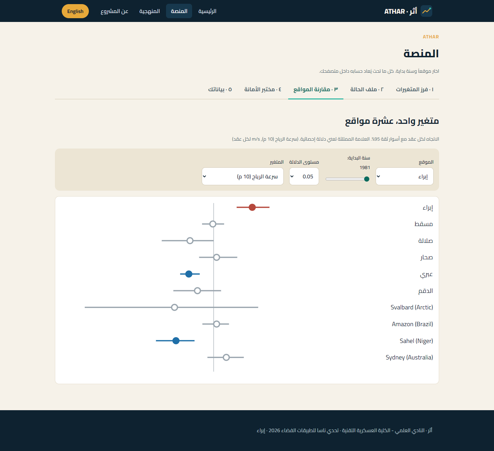
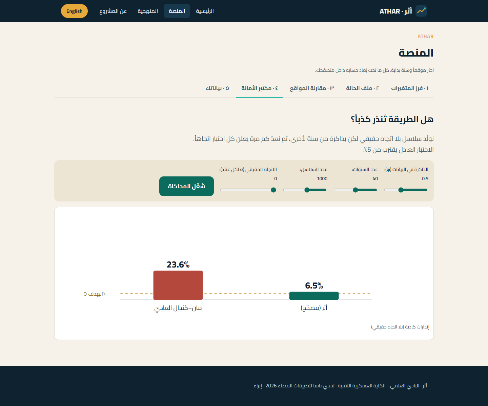

<div align="center">

# ATHAR · أثر

### Earth System Trend Detective

Which NASA Earth variables are really changing, where, by how much, and is the change statistically real?

[**Live website**](https://thesaifalsaidi.github.io/athar-earth-trend-detective-mtc/) ·
[**Source code**](https://github.com/thesaifalsaidi/athar-earth-trend-detective-mtc) ·
[**Demos**](https://drive.google.com/drive/folders/1NZC1-W_uAN-bRVDlgUx8QSemjXXROaLL)


</div>

---

## Overview

**ATHAR** (أثر, "trace" in Arabic) is a bilingual (Arabic / English) tool built for the
**NASA Space Apps Challenge 2026**, challenge *"Be an Earth System Trend Detective!"*.

For any NASA-measured or NASA-modelled variable it answers four questions:

| Question | Answer produced |
|---|---|
| **What** is changing? | Variables ranked by a 0-100 detectability score |
| **Where**? | Place-by-place comparison, with regional maps in the Python engine |
| **How much**? | Theil-Sen slope per decade with a 95% confidence interval |
| **Is it real**? | Mann-Kendall test with lag-1 correction and Benjamini-Hochberg FDR control |

Each result is turned into a plain-language case file in Arabic and English. The text is
template-based, so it never contains invented numbers.

## Features

- **Triage**: ranks candidate variables and labels each one *Strong lead*, *Moderate lead* or *Noise / inconclusive*.
- **Case file**: trend chart, confidence band, change-point (Pettitt) and a written summary.
- **Place comparison**: the same variable across ten locations, six of them in Oman.
- **Honesty lab**: Monte-Carlo simulation of the false-alarm rate of a plain Mann-Kendall test versus the corrected one.
- **Your own data**: paste a CSV of year, value pairs and get the same analysis.
- **Arabic (RTL) and English** interface; works offline.

## Screenshots

| Triage | Case file |
|---|---|
|  |  |
| **Compare places** | **Honesty lab** |
|  |  |

All screens: [docs/screenshots/SCREENSHOTS.md](docs/screenshots/SCREENSHOTS.md)

## Quick start

### Website (no install)

The site in [`docs/`](docs/) is static (HTML, CSS and vanilla JS). The statistics run in the
browser using [`docs/js/engine.js`](docs/js/engine.js), a port of the Python engine, on bundled
NASA POWER annual data (1981-2025).

```bash
cd docs
python -m http.server 8600
```

Then open <http://localhost:8600>. It is published with GitHub Pages from the `main` branch, `/docs` folder.

### Try it with a sample file

[`docs/sample/WS10M_ibra_1981-2025.csv`](docs/sample/WS10M_ibra_1981-2025.csv) is an export from the platform:
annual mean wind speed at 10 m (m/s) for Ibra, Oman, 1981-2025 (columns `year,value,trend_line`).

1. Open the **Your data** tab (٥ · بياناتك).
2. Choose the sample file, or paste its rows into the text box.
3. Name the series `Wind speed 10 m`, set the unit to `m/s`, then press **Analyze**.

Expected result: Theil-Sen trend of about **+0.052 m/s per decade**, p < 0.0001, a statistically real increase.
Only the first two columns (`year,value`) are used; a header row and extra columns are ignored.

### Python engine

```bash
pip install -r requirements.txt
python -m pytest -q
```

The tests check Mann-Kendall and Sen's slope against the independent `pymannkendall` library,
FDR control, false-alarm calibration and the story generator.

Optional workflow for real satellite granules (GPM IMERG, MODIS, SMAP, GRACE):

```bash
pip install earthaccess xarray netcdf4
```

then see `athar/data_sources.py::load_earthaccess_netcdf`.

## Project structure

```text
athar/
├── athar/                  Python statistics engine
│   ├── stats_engine.py     Mann-Kendall (lag-1 corrected), seasonal MK, Theil-Sen + CI, Pettitt, BH-FDR
│   ├── data_sources.py     NASA POWER fetch + disk cache, CSV loader, earthaccess loader, catalogue
│   ├── triage.py           Variable ranking (0-100 detectability score)
│   ├── regional.py         Map trends + FDR + "opposite story" detector
│   ├── story.py            Template-based Arabic / English case files
│   └── validate.py         Monte-Carlo false-alarm rate and power
├── docs/                   Static website (served by GitHub Pages)
│   └── sample/             Sample CSV for the "Your data" tab
├── site/                   Copy of the website for other static hosts
├── tests/                  Unit tests
└── requirements.txt
```

## Data and citation

Data come from **NASA POWER** (MERRA-2 reanalysis and CERES SYN1deg), <https://power.larc.nasa.gov>.
Please cite NASA POWER in any publication that uses these results.

Statistical methods: Mann (1945), Kendall (1975), Theil (1950), Sen (1968), Pettitt (1979),
Benjamini and Hochberg (1995).

## Team

**Science Club, Military Technological College (MTC), Ibra, Oman**, local event hosted by UTAS Ibra.

- Saif Sultan Alsaidi
- Habib Hamed Alshammakhi
- Jassim Khalid Almuttawa
- Omran Nadir Alkalbani
- Muhannad Muhsen Alalawi
- Ammar Nasir Albalushi
