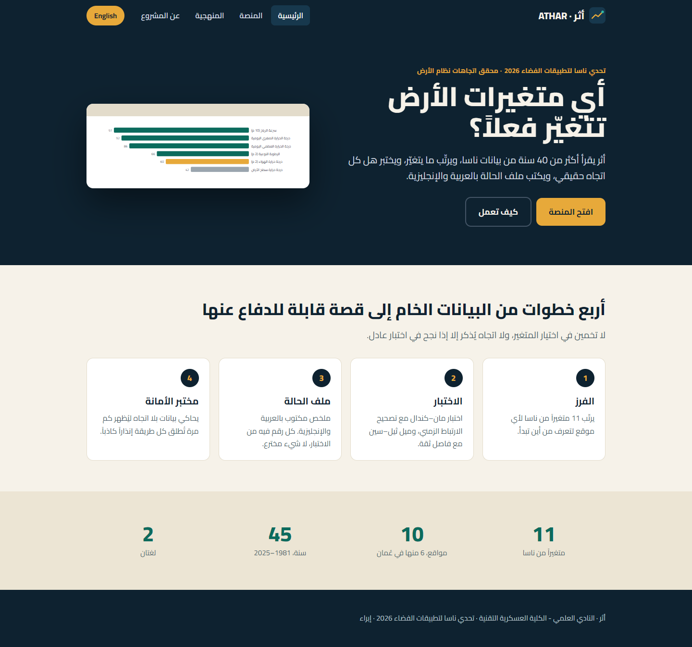
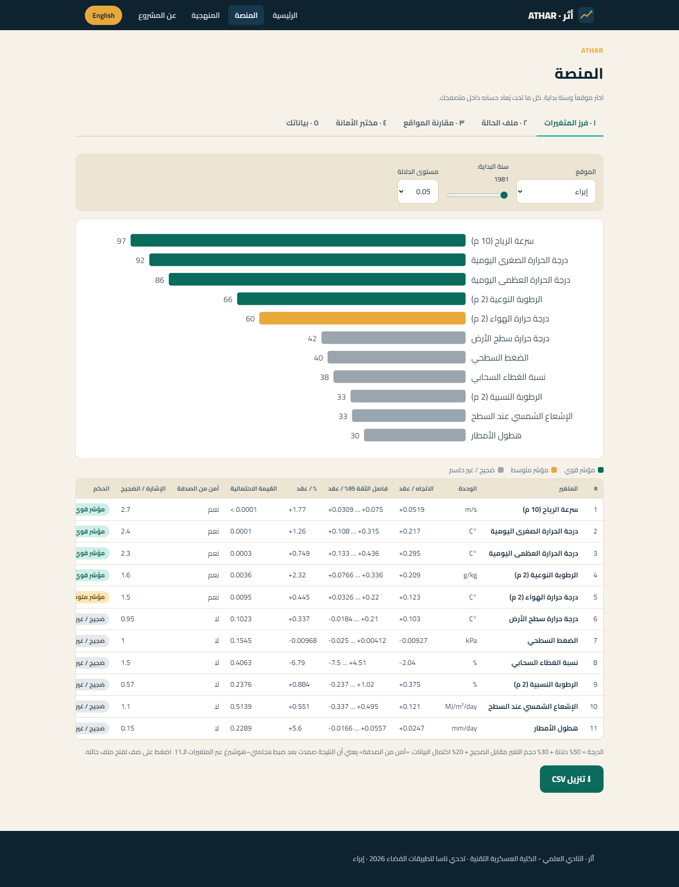
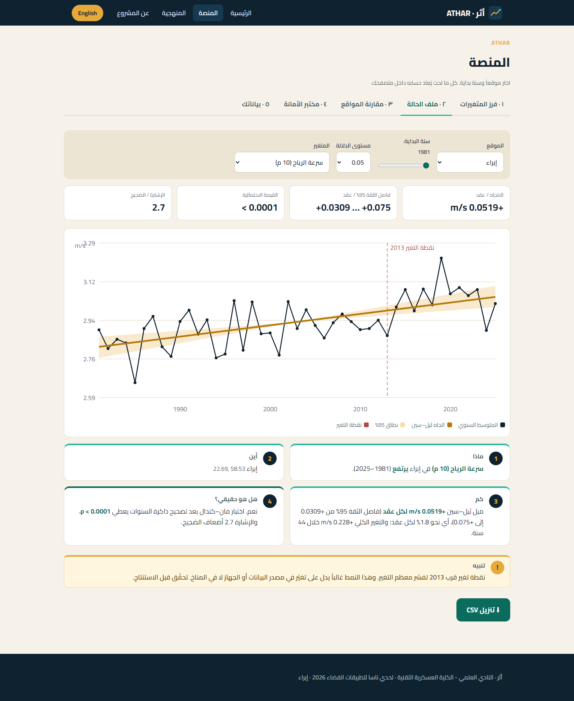
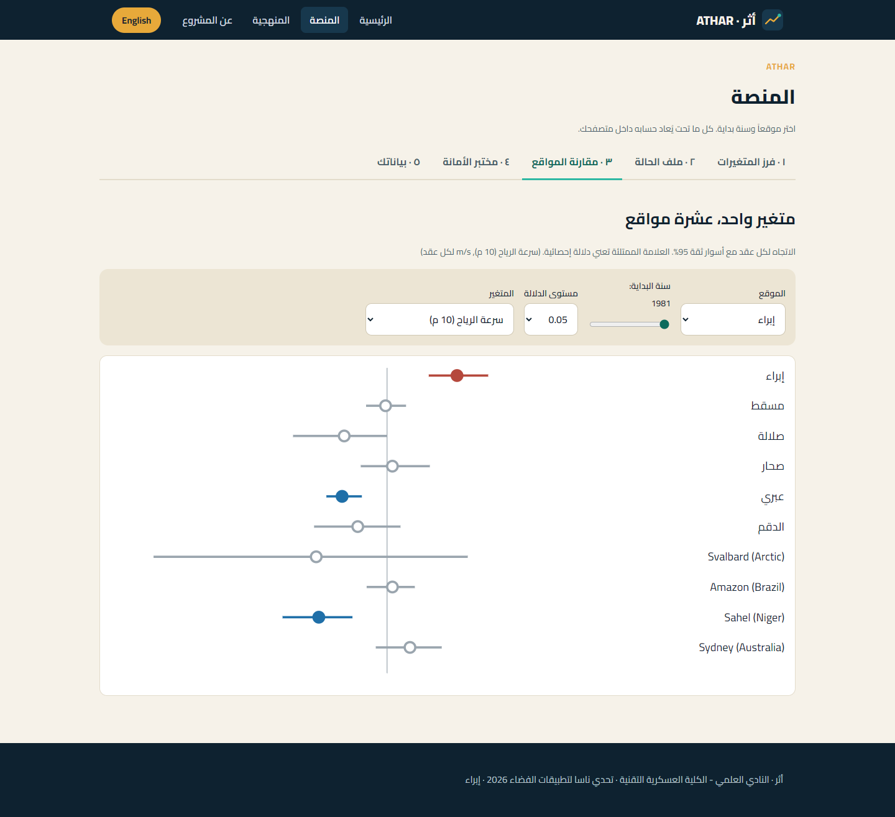
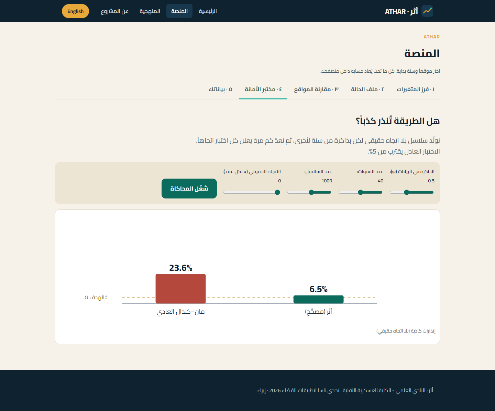
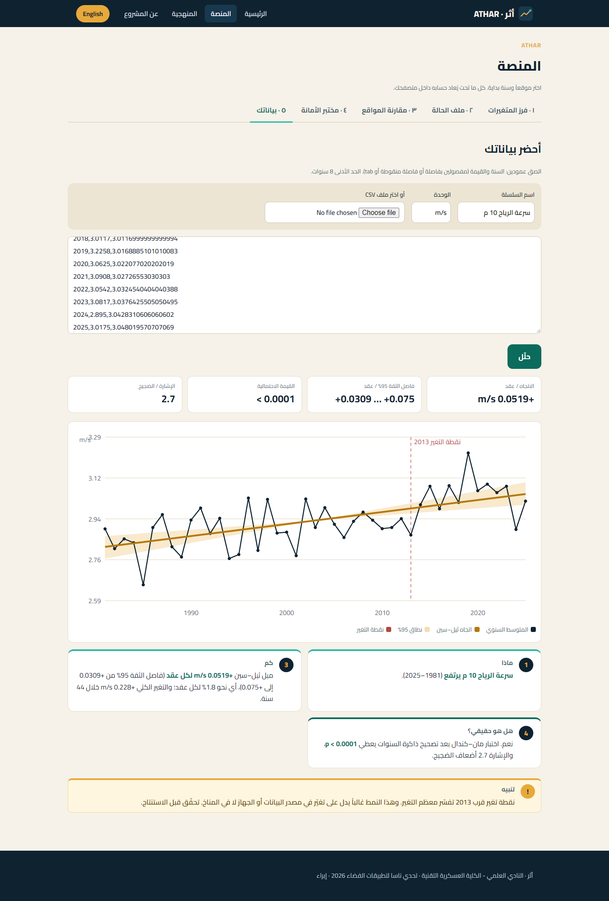
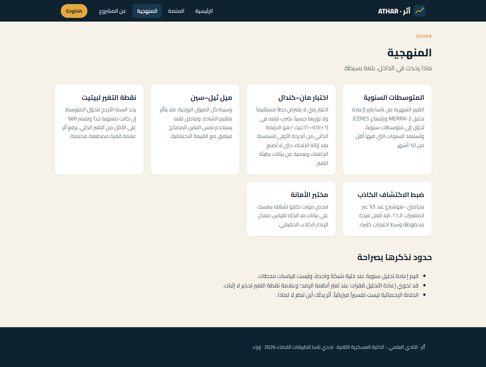
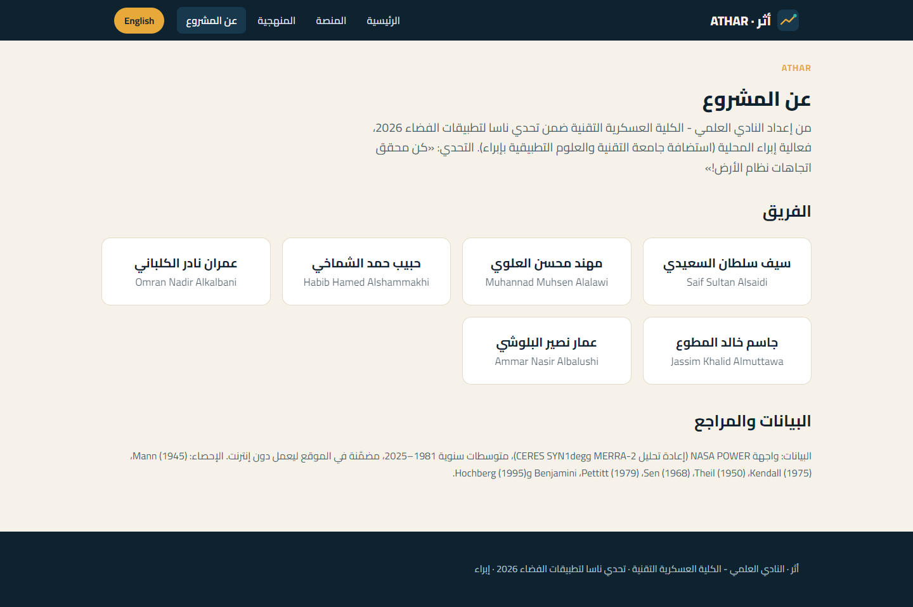

# ATHAR · Screenshots

Desktop captures (1440 px wide, full page) of the static website in Arabic (RTL).

## 1. Home

The landing page: what ATHAR does and the headline numbers.

## 2. Platform · Triage

Ranks every NASA variable by detectability score, with trend, 95% CI, p-value and FDR flag. Includes CSV download.

## 3. Platform · Case file

Trend chart with Theil-Sen line, confidence band and change point, plus the written case file in five cards.

## 4. Platform · Compare places

The same variable across ten places, with 95% trend intervals. Filled markers are statistically significant after FDR.

## 5. Platform · Honesty lab

Monte-Carlo false-alarm test: plain Mann-Kendall versus the lag-1 corrected test.

## 6. Platform · Your data

Paste or upload year,value rows. Shown with the sample file `../sample/WS10M_ibra_1981-2025.csv`.

## 7. Method

The method explained in plain language, with its limits.

## 8. About

Project, team, data sources and references.

